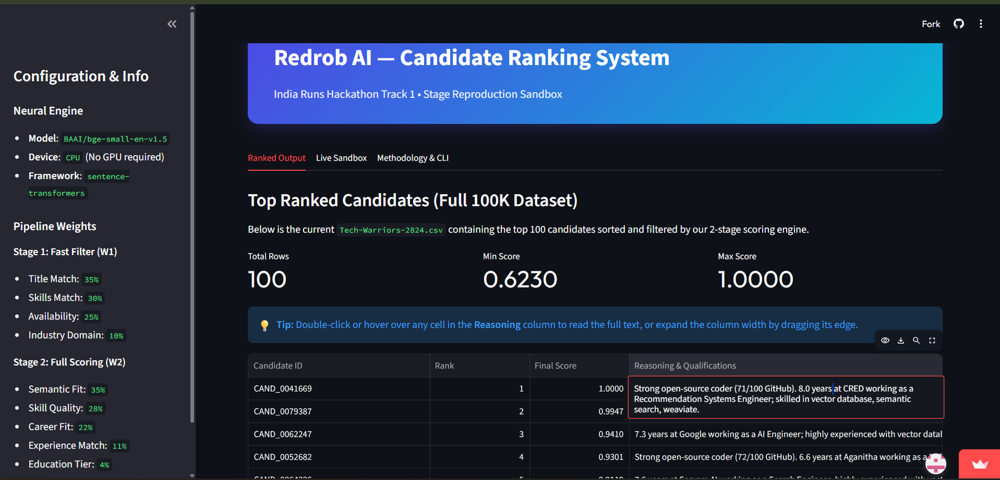

# India Runs: Candidate Ranking System

A two-stage candidate screening pipeline that scores and ranks 100,000 applicant profiles against a job description using structured filtering and local semantic embeddings.

---

## What It Does

This system helps hiring teams discover the most qualified candidates from a dataset of 100,000 candidate profiles. It first removes unqualified applicants using fast structured rules, then measures how closely remaining candidates match a target job description using semantic text embeddings. Finally, it outputs a ranked list of the top 100 candidates with fact-based, automated reasoning explaining each ranking decision.

---

## Live Demo

Interactive Streamlit demo: [Redrob Candidate Ranker](https://dhiraj2822-redrob-ranker.streamlit.app)



---

## Features

- **Two-Stage Screening Pipeline:** Filters 100,000 raw candidate profiles down to 2,000 via structured rules before running dense neural inference on the top candidates.
- **Local Neural Embeddings:** Generates vector representations using `BAAI/bge-small-en-v1.5` on CPU, ensuring zero external API calls or network access during ranking.
- **Multi-Factor Weighted Scoring:** Blends semantic similarity (35%), skill quality (28%), career history fit (22%), years of experience (11%), and education tier (4%) with an activity and responsiveness multiplier.
- **Rule-Based Honeypot & Fraud Detection:** Runs 6 automated integrity checks and 21 edge-case handlers to identify keyword stuffers, impossible claims, and fictitious employers.
- **Fact-Based Candidate Reasoning:** Automatically generates non-templated, transparent hiring rationales using verified profile attributes without language model hallucination.
- **Dual Interface & Container Support:** Features a CLI runner, an interactive 3-tab Streamlit web application, and a self-contained Docker image for isolated offline evaluation.

---

## How It Works

1. **Load candidate profiles:** The pipeline reads candidate records from a JSONL file (`candidates.jsonl`). A JSONL file is a plain-text file where each line contains a single JSON record.
2. **Execute Stage 1 structured pre-filter:** The system evaluates all 100,000 profiles using attribute checks covering job title relevance, required skill counts, candidate availability, and domain industry fit. It keeps the top 2,000 candidate profiles for Stage 2.
3. **Compute semantic text embeddings:** The system encodes candidate summary text and the target job description into vector embeddings using `BAAI/bge-small-en-v1.5`. An embedding is a numerical vector that captures the semantic meaning of text so algorithms can compare topical similarity.
4. **Calculate Stage 2 core scores:** The system measures cosine similarity between each candidate embedding and the job description embedding. Cosine similarity is a mathematical metric that measures the angular alignment between two vectors on a scale from 0.0 to 1.0. The system combines semantic similarity with skill quality, career trajectory, experience length, and education tier to calculate a 5-component core score.
5. **Apply behavioral multipliers:** The system computes a behavioral multiplier using candidate responsiveness, platform activity recency, and open-to-work flags, multiplying it with the core score to produce the candidate base score.
6. **Detect honeypots and evaluate edge cases:** The system runs 6 anomaly checks to flag honeypots. A honeypot is an artificially fabricated profile designed to trap flawed screening systems by claiming impossible credentials (such as expert proficiency with zero duration or tenure at fictional companies). Flagged honeypots receive a score of 0.0. The system then applies 21 edge-case penalty and bonus handlers to adjust scores.
7. **Rank candidates with deterministic tie-breaking:** The system normalizes final scores between 0.0 and 1.0, rounds scores to 4 decimal places, and sorts candidates in descending order. If two candidates have identical rounded scores, the system breaks the tie alphabetically by candidate ID.
8. **Generate transparent candidate reasoning:** The reasoning engine inspects verified candidate metrics (tenure length, current role, and core skills) to generate a concise summary sentence explaining why the candidate was selected.

---

## Prerequisites

- **Python:** Version 3.11.x is required for compatibility with pinned dependencies.
  ```bash
  python --version
  ```
  Expected output:
  ```text
  Python 3.11.x
  ```

- **Docker:** Version 20.10 or later (optional, for containerized execution).
  ```bash
  docker --version
  ```
  Expected output:
  ```text
  Docker version 20.10.x (or newer)
  ```

- **System Resources:**
  - CPU: Minimum 4 cores (8 cores recommended).
  - RAM: Minimum 8 GB (16 GB recommended for the full 100,000 record dataset).
  - Disk: 1 GB free space for code and model caches; 500 MB additional space for `candidates.jsonl`.
  - Network: Required once during setup (`precompute.py` or `docker build`). Zero network connection is used during ranking inference.

---

## Installation

1. **Clone the repository:**
   ```bash
   git clone https://github.com/Dhiraj2822/India_runs_hackathon.git
   cd India_runs_hackathon
   ```

2. **Create and activate a virtual environment:**
   On Linux or macOS:
   ```bash
   python -m venv venv
   source venv/bin/activate
   ```
   On Windows (PowerShell):
   ```powershell
   python -m venv venv
   .\venv\Scripts\Activate.ps1
   ```

3. **Install Python package dependencies:**
   ```bash
   pip install -r requirements.txt
   ```

4. **Pre-download model weights and language resources:**
   Run the precomputation script with active network access to download the spaCy `en_core_web_sm` model and pre-cache the `BAAI/bge-small-en-v1.5` HuggingFace weights:
   ```bash
   python precompute.py
   ```
   Expected output:
   ```text
   ==================================================
     Pre-computation — India Runs Track 1
     Run this once. Then run rank.py.
   ==================================================

   [1/3] Downloading spaCy model...
         spaCy en_core_web_sm ready.

   [2/3] Downloading BAAI/bge-small-en-v1.5 (133 MB)...
         Model cached in ...s

   [3/3] Smoke test: loading sample candidates...
         Loaded 50 sample candidates.
         Embedding shape: (384,)

   ==================================================
     Pre-computation complete.
   ==================================================
   ```

5. **Place candidate dataset:**
   Place the uncompressed `candidates.jsonl` dataset (100,000 records) into the `data/raw/` directory:
   ```text
   data/raw/candidates.jsonl
   ```
   > [!NOTE]
   > The repository includes `data/raw/sample_candidates.json` (50 records) for smoke testing and Streamlit sandbox runs. Full ranking with `rank.py` requires a file containing at least 100 candidate records.

---

## Usage

### 1. Run Locally via CLI

Run the full ranking pipeline on the candidate dataset:
```bash
python rank.py --candidates data/raw/candidates.jsonl --out Tech-Warriors-2824.csv
```
Expected output:
```text
Loading candidates from: data/raw/candidates.jsonl...
Loaded 100,000 candidates in ...s
Loading model and embedding Job Description...
Model and JD loaded in ...s
Running ranking pipeline...
  Stage 1: scoring 100,000 candidates...
  Stage 1 complete: 2,000 candidates retained (...)
  Stage 2: embedding 2,000 candidates...
  Embedding complete (...)
  Stage 2: full scoring + edge cases...
  Full scoring complete (...)
Writing submission to: Tech-Warriors-2824.csv...
*** Pipeline completed successfully! ***
```

Validate the output CSV structure and schema:
```bash
python validate_submission.py Tech-Warriors-2824.csv
```
Expected output:
```text
Submission is valid.
```

Audit ranking quality, score spreads, and honeypot filters:
```bash
python validate_quality.py --submission Tech-Warriors-2824.csv --candidates data/raw/candidates.jsonl
```
Expected output:
```text
[PASS] Row count: 100 (must be 100)
[PASS] Columns: ['candidate_id', 'rank', 'score', 'reasoning']
[PASS] Ranks 1-100 unique: True
[PASS] Scores non-increasing: True
[PASS] No obvious honeypots detected in top 100
...
FINAL VERDICT: [PASS] LOOKS GOOD — ready to submit
```

Launch the interactive Streamlit dashboard:
```bash
streamlit run streamlit_app.py
```

### 2. Run via Docker

Build the Docker image with pre-cached models:
```bash
docker build -t india-runs-ranker .
```

Execute the containerized ranking process in fully isolated offline mode:
On Linux or macOS:
```bash
docker run --rm \
  -v "$(pwd)/data/raw/candidates.jsonl:/app/data/raw/candidates.jsonl:ro" \
  -v "$(pwd)/output:/app/output" \
  --network none \
  india-runs-ranker \
  python rank.py --candidates /app/data/raw/candidates.jsonl --out /app/output/Tech-Warriors-2824.csv
```
On Windows (PowerShell):
```powershell
docker run --rm `
  -v "${PWD}/data/raw/candidates.jsonl:/app/data/raw/candidates.jsonl:ro" `
  -v "${PWD}/output:/app/output" `
  --network none `
  india-runs-ranker `
  python rank.py --candidates /app/data/raw/candidates.jsonl --out /app/output/Tech-Warriors-2824.csv
```

### 3. Example Input and Output

**Input candidate record (`candidates.jsonl` snippet):**
```json
{
  "candidate_id": "CAND_0041669",
  "profile": {
    "current_title": "Recommendation Systems Engineer",
    "current_company": "CRED",
    "years_of_experience": 8.0,
    "location": "Bangalore"
  },
  "skills": [
    {"name": "vector database", "proficiency": "expert", "duration_months": 48},
    {"name": "semantic search", "proficiency": "expert", "duration_months": 36},
    {"name": "weaviate", "proficiency": "advanced", "duration_months": 24}
  ],
  "redrob_signals": {
    "open_to_work_flag": true,
    "github_activity_score": 71.0,
    "response_rate": 0.77
  }
}
```

**Output ranked record (`Tech-Warriors-2824.csv` row 1):**
```csv
candidate_id,rank,score,reasoning
CAND_0041669,1,1.0,"Strong open-source coder (71/100 GitHub). 8.0 years at CRED working as a Recommendation Systems Engineer; skilled in vector database, semantic search, weaviate."
```

---

## Running Tests

Execute the full automated test suite using `pytest`:
```bash
pytest tests/ -v
```
Expected output:
```text
tests/test_module1.py ............                                       [ 20%]
tests/test_module2.py ..........                                         [ 37%]
tests/test_module3.py ..........                                         [ 54%]
tests/test_module4.py ..........                                         [ 71%]
tests/test_module5.py .........                                          [ 86%]
tests/test_module6.py ........                                           [100%]

============================== 59 passed in ...s ===============================
```

> [!NOTE]
> If your environment has `pytest-asyncio` installed, invoke pytest with `-p no:asyncio` to avoid third-party plugin collection conflicts:
> ```bash
> pytest tests/ -v -p no:asyncio
> ```

---

## Project Structure

```text
india_runs_track1/
├── config.py                 # Central configuration for scoring weights, constants, and job description
├── Dockerfile                # Multi-stage Docker container recipe with offline model caching
├── precompute.py             # Setup script to pre-download spaCy models and BGE weights
├── rank.py                   # Main CLI entry point to rank candidates and export results
├── requirements.txt          # Python package dependency specifications
├── streamlit_app.py          # Interactive web UI (Ranked Output, Live Sandbox, and Methodology)
├── validate_quality.py       # Quality audit script checking distribution, top-10 quality, and honeypots
├── validate_submission.py    # Format validator verifying CSV row count and header schema
├── data/
│   └── raw/
│       ├── candidates.jsonl      # 100,000 candidate dataset (local file, gitignored)
│       └── sample_candidates.json# 50 sample profiles for smoke testing and UI sandbox
├── src/
│   ├── __init__.py           # Python package indicator
│   ├── data_loader.py        # Streamlined JSONL parsing and dataclass instantiator
│   ├── edge_cases.py         # 21 penalty and bonus handlers plus 6 honeypot checks
│   ├── models.py             # Typed dataclass schemas for candidates, scores, and job description
│   ├── nlp_engine.py         # SentenceTransformer wrapper and cosine similarity utilities
│   ├── ranker.py             # Pipeline orchestrator managing filtering, sorting, and CSV writing
│   ├── reasoning.py          # Hallucination-free candidate reasoning generator
│   └── scoring_engine.py     # Stage 1 fast filter and Stage 2 multi-factor scoring functions
└── tests/
    ├── test_module1.py       # 12 tests for data parsing, validation, and schema bounds
    ├── test_module2.py       # 10 tests for embedding generation and vector similarity
    ├── test_module3.py       # 10 tests for Stage 1 filtering and Stage 2 core scoring
    ├── test_module4.py       # 10 tests for honeypot traps and edge-case adjustment rules
    ├── test_module5.py       # 9 tests for pipeline output format, ranking, and tie-breaks
    └── test_module6.py       # 8 tests for candidate reasoning accuracy and factuality
```

---

## Limitations and Known Issues

- **Minimum Candidate Count for CLI Ranker:** `rank.py` enforces a strict output count of exactly 100 rows (`TOP_K_FINAL = 100`). Running `rank.py` on files with fewer than 100 candidates (such as `sample_candidates.json`) raises an assertion error. For inputs smaller than 100 candidates, use the interactive Streamlit sandbox instead.
- **Test Suite Runtime:** Several test modules load and parse the full 475 MB `candidates.jsonl` file directly from disk without database caching. Running all 59 tests can take between 5 to 10 minutes depending on disk read speeds.
- **Initial Network Dependency:** Although the ranking pipeline runs strictly offline with zero network connectivity during inference, running `precompute.py` or building the Docker image requires active internet access once to download the 133 MB BGE weights and spaCy pipeline.
- **Deterministic Keyword Boundaries:** Stage 1 structured filtering depends on exact keyword matching and predefined role lists. Candidates with highly unconventional or non-standard titles for AI/ML roles may receive lower Stage 1 scores prior to Stage 2 semantic evaluation.
